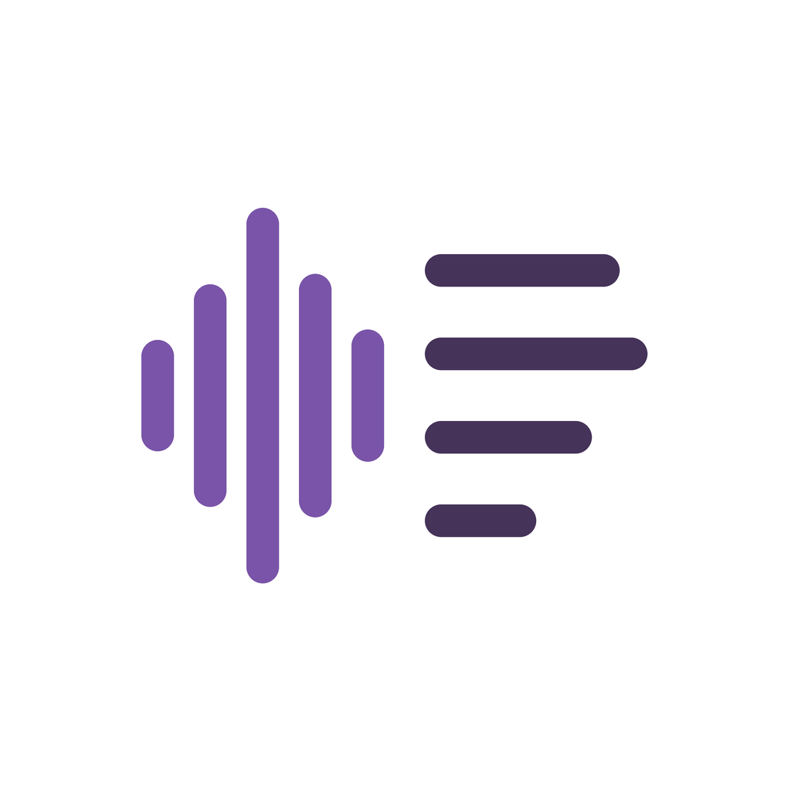

<p align="center">
  
</p>

<h1 align="center">NixScribe</h1>
<p align="center"><strong>Your recordings. Your Mac. Your words.</strong></p>

<p align="center">
  <a href="https://github.com/NixMcRetro/NixScribe/releases/latest"></a>
  
  
</p>

Turn recordings into words, right on your Mac. NixScribe is a local English transcription app built for Apple silicon. No cloud transcription service required.

## ✨ What's inside?

- 🎙️ Transcribe audio and video with MLX Whisper.
- 👥 Identify who's speaking with Pyannote or fast FluidAudio Core ML.
- ⚡ Let Apple silicon do the heavy lifting, with automatic fallbacks.
- 📝 Save readable transcripts, timed subtitles and optional MP3s.
- 🔒 Keep your recordings private and originals untouched.
- 📁 Give every transcription its own dated project folder.

## 🚀 Get recording

**Apple silicon · macOS 15+ · Internet for initial model downloads**

1. Grab the app from [Releases](https://github.com/NixMcRetro/NixScribe/releases) or a [successful macOS build](https://github.com/NixMcRetro/NixScribe/actions/workflows/build-macos.yml?query=is%3Asuccess) (temporary **Artifacts**; check the branch or tag).
2. Unzip, move NixScribe to Applications and open it.
3. Choose a recording, leave the speaker count on Auto or set it manually, and press **Start**.

For Pyannote speaker identification, accept the [Pyannote model terms](https://huggingface.co/pyannote/speaker-diarization-community-1) and save a [Hugging Face read token](https://huggingface.co/settings/tokens) in the app. Models download once and are reused. If macOS blocks the unnotarised app, see the [setup guide](docs/technical-guide.md#build-from-source).

## 🍎 Small app. Serious silicon.

On an M5 Mac, one 83.1-second test recording went from **78 seconds to 14 seconds** with cached models. That's approximately **5.6× faster**.

MLX handles recognition on the GPU. Pyannote GPU is the quality-first speaker identification default; FluidAudio Core ML is available for speed, and Pyannote CPU remains a fallback.

*One short-recording benchmark, not a guarantee. Speaker accuracy and longer recordings are still being evaluated.*

## 📂 Everything in its place

```text
~/Documents/NixScribe/
└── 2026-11-25 Interview/
    ├── Interview.txt
    ├── Interview.srt
    └── Interview.mp3
```

Readable words, timed subtitles and optional audio. No overwriting earlier projects.

## 🧭 What's next?

- **v0.3.0** · Apple silicon acceleration
- **[v0.3.1](https://github.com/NixMcRetro/NixScribe/releases/tag/v0.3.1)** · Diarization validation, backend selection and interface polish
- **v0.3.2** · Speaker-count estimation and short-duration speaker recovery
- **v0.4.0** · Multi-source transcription
- **v0.5.0** · Local AI-assisted reconciliation

## 🛠️ Curious how it works?

[Technical guide](docs/technical-guide.md) · [Build from source](docs/technical-guide.md#build-from-source) · [Report an issue](https://github.com/NixMcRetro/NixScribe/issues)

Powered by [WhisperX](https://github.com/m-bain/whisperX), [Faster-Whisper](https://github.com/SYSTRAN/faster-whisper), [MLX Whisper](https://github.com/ml-explore/mlx-examples/tree/main/whisper), [FluidAudio](https://github.com/FluidInference/FluidAudio), [Pyannote](https://github.com/pyannote/pyannote-audio) and [FFmpeg](https://ffmpeg.org/).
